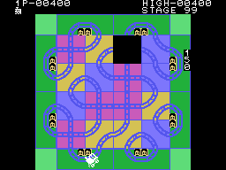

# Curiosities

## The bugs

### A high score ten points higher than the game

When the train enters a square with no way out, it is first given the **10
points** of the new square and then it crashes. The game loop paints the score
(`pinta_puntos`, 0x056B) and right after that checks the high score
(`mira_record`, 0x056E); if the interrupt falls **between the two**, the high
score gets those 10 points and the player's score does not, because after the
crash it is not painted again. On the last train, it stays like that for good:

Measured in the `empuja.tcl` recording: on frame 2057 the RAM holds 290
points and a 290 high score, and the screen, 280 and 290.

### After stage 99, stage 02

When a stage starts its number goes up by one, in BCD; if it goes from 99 to
00, the program puts **2** (0x032C). Tried in openMSX with the stage set to 98
(`fase99.tcl`): STAGE 99 and then STAGE 02.

### The demo runs off its strip

The demo takes one push per square from a strip of 16 (0x13E2) without
checking where it ends: if the train lasts longer, it reads the **title text**
as if it were pushes. In one of the recorded demos it got to square 24
(0xE261 = 24).

### STAGE 01 out of turn

In the demo the stage is not painted at the start, but `cierra_estacion`
(0x0A14) repaints it without checking for the demo: "STAGE 01" appears when
the first station closes.

## What looks like a bug and is not

`pinta_cifras` (0x0C16) gives the extra life when the score **is** 5,000 (or
30,000, 60,000, 90,000), not when it goes past it: it looked as if a score
jumping over the threshold -a station gives 90 at once- would miss it. But in
the comparison, B is no longer the tens: `ld b,a` (0x0C2F) has overwritten it
with the extra lives already given, and the `djnz` leaves it at zero. Only the
**thousands** count, and they go up one at a time, so the life is never
missed. Tried in openMSX with the score at 4,900 and at 4,910 before a
station: both times, one more train.

## Each train's code lives in RAM

Each train has a 32-byte record (the template at 0x12B7), and **it carries
code inside**: `ld b,(ix+n)`, `inc (hl)` on its own offset `n`, and
`jp 0x0850`. `paso_de_tren` (0x0843) jumps into it with `jp (hl)`: it reads
the next byte of the train's script and adds one to itself. That is why there
is code in the ROM nothing jumps to: 0x0850 and what follows.

## Tables that overlap

Four tables in a row (0x1297, 0x129F, 0x12A7 and 0x12AF) are read with an
index that starts at 1, so entry 0 of each is the last bytes of the previous
one. And the last nine bytes of the train-record template are the first nine
of the exit table (0x12CE): the template is copied whole to RAM, with that bit
of table inside.

## Five pairs out of six

`psg_inicial` (0x0F1F) lowers B three times per pair (the two `outi` and the
`djnz`). Here the sums add up: with B = 0x12 it sends the six pairs at 0x133A,
and it only does that when a stage starts (0x0453); with B = 0x0F, before each
tune, the first five, without the last one, which opens the noise on channels
2 and 3 for the clatter.

## The third voice, late

`canal_musica` (0x0103) does not reset what is left of a note when its piece
is changed. The stage-cleared tune comes in while channel 3 is still playing
the clatter, so its third voice starts late by whatever was left of that note:
0 to 7 frames. In the recording, 1 (0xE3B2 = 1 on frame 1205).

## Leftovers

- A **stray `ret`** at 0x084F, after the `jp (hl)` of `paso_de_tren`: no jump
  reaches it. Measured with a probe in openMSX (`tools/sonda_ret.tcl`): in
  20,000 frames of play with pushes, not once (the same probe on 0x0850
  counts 65 in 3,000).
- The **24 inner squares of the fourth board** (0x1244-0x1261): from stage 4
  the inside is always shuffled, and they are never seen.

## The dump

The 32 KB dump (GoodMSX, `[!]`, sha1 `bbe8df03...`) is the one used: it is
the same 8 KB four times. openMSX knows **twelve** dumps of Crazy Train, this
one as GoodMSX, and none marked as verified; the 8 KB on their own (sha1
`8aca0ee5...`) are on its list too.

## Open questions

- **Why a 2** after stage 99, and not a 1.
- **The other dumps** on openMSX's list: how they differ from this one.
