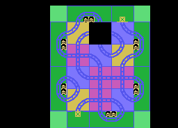
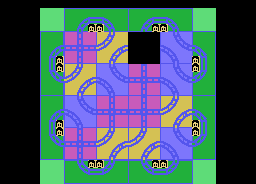
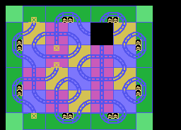
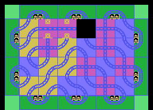
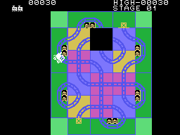
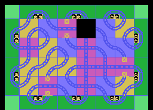
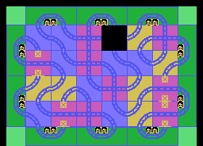
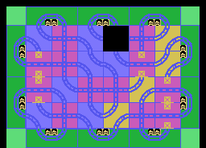
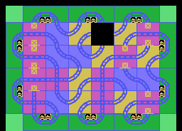

# The boards

The cartridge holds **four boards** of 8 x 6 squares (0x11AB, 48 bytes each)
and, for each one, the list of its stations (0x115F). Every stage starts with
its board, the hole on square 12 and the white train on a crossing, square 28,
facing up (the template at 0x12B7). When a stage is cleared the next board
comes; from the fourth one on, the inside is **shuffled** on every stage.

The pictures come from **the cartridge's bytes**: the board in the ROM, square
by square with its tiles, painted with the characters and colours the
cartridge itself uploads to the VRAM (`tools/graficos.py`, which runs INIT with
`tools/z80run.py`). Each one has been checked **dot by dot** against the
openMSX screen at the start of that stage: **0 different dots** in all eight,
from row 2 to row 23 (the first two carry the scores).

| Stage | Board | Inside | Stations |
|---|---|---|---|
| 1 | the first | 3 x 4 | 6 |
| 2 | the second | 4 x 4 | 8 |
| 3 | the third | 5 x 4, with a straight | 8 |
| 4 onwards | the fourth, shuffled | 6 x 4, with straights | 10 |

## Stage cleared

With the last station the stage tune plays, 200 points are added and the next
board comes (`fase_superada`, 0x03BD).

## The fourth board, shuffled

From stage 4, `tablero_revuelto` (0x0B5A) fills the 24 inner squares from a
strip of 18 tiles (0x126B), starting at a place that depends on the stage
number, and puts the hole on 12 and a crossing on 28. Then it turns a few
squares into **straights** (tile 0x14, which only lets you through sideways),
at the places of a list (0x127E): two on stage 4, one more each stage up to
six on stage 8, six up to stage 14, seven from 15 to 20 and eight from 21.

Two measured details:

- The number it uses is the **previous stage's**: the board is prepared
  (0x0313) before the stage number goes up (0x0320). Stage 4 is shuffled with
  a 3.
- The 24 inner squares of the fourth board in the ROM (between 0x1244 and
  0x1261) **are never seen**: from stage 4 the inside is always shuffled, and
  covers them all.

The stage number is BCD, and what counts for the starting place is mostly its
last digit. Worked out with the same program that gives the checked boards:
from stage 21 onwards **the boards repeat every ten stages** (31 is 21, 32 is
22...): there are only ten different ones.
