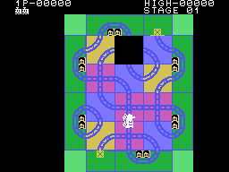
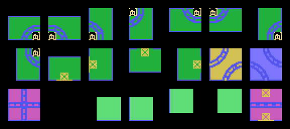
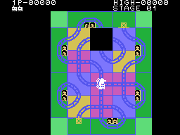
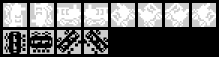
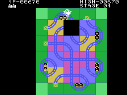
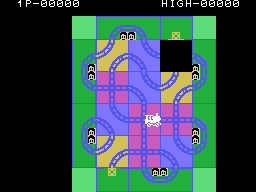
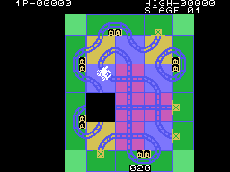

# The game

The board is a sliding-tile puzzle with one hole, and a train runs on top of
it. The train **moves by itself** along the tracks; the controller does not
move it: it **pushes into the hole** the tile on the opposite side
(`mando_empuja`, 0x0F5F). That is how you keep laying track in front of it, and
you have to take it through **every station** on the frame to clear the stage.

Every GIF on this page is the cartridge **running in openMSX**: on every frame
the VRAM and the VDP registers are logged, and `tools/vdp.py` paints them. Each
picture lasts as long as it lasted in the emulator.

## The tiles

The board is 8 x 6 squares of 4 x 4 characters (`pinta_tablero`, 0x0402);
each square holds the number of its tile. Inside the frame there are two
double-curve tiles (0x0C and 0x0D), the crossing (0x0E), the straight (0x14,
only on the shuffled boards) and the hole (0x0F). The frame is made of the
corners (0x10-0x13), the stations (0x00-0x07, two squares per station) and the
plain frame, with a cross (0x08-0x0B). Frame tiles **do not move**: a push only
works on tiles from 0x0C up (0x0FDB).

## The push

Up, down, left or right move the tile next to the hole into it, in **four
steps of 8 dots**, one per frame (`desliza`, 0x0FEF). Between pushes you have
to **let go** of the controller (0x0F8E). If the train is on the tile, **it
moves with it** (`mueve_con_pieza`, 0x104E).

## The train and its speed

The white train moves **one dot every four frames**; diagonally, one or two
frames more per dot (the interrupt, 0x0086). The button (or the space bar)
speeds it up: held for 32 frames in a row, one frame less per dot, down to
two; released for 32 frames, it slows down again, back to four
(`boton_acelera`, 0x0594).

Each tile takes the train through a **script** of steps: a straight is 32 dots
in a line; a curve, 5 straight, 11 diagonal and 5 straight (the scripts at
0x12FA). Where it comes out is given by a table, from the tile and the side it
enters by (`salidas`, 0x12CE).

## The crash

The white train crashes, and a life is lost (`fin_de_fase`, 0x06C3), when:

- it reaches a tile with **no track on that side**: the hole, the plain frame
  or a straight from above or below (`callejon`, 0x0874);
- it tries to enter the tile that **is sliding** (0x0EC6), or reaches the end
  of its tile while that tile is still sliding with it on top (0x0864);
- it **touches a black train** (`choque_blanco`, 0x04AC).

After the explosion the train carries on. If it crashed into a dead end, it
**turns round** and goes back to the square it came from: for a tile with no
track, the exit table gives back the side it entered by (0x12CE). If it
crashed just after leaving a station, it starts from **another station at
random** among the ones left (0x06F5).

## The stations

Each station is **two squares** of the frame, with its little houses. The
train visits it when it goes through both (`entra_en_casilla`, 0x0DD6): a chime
plays, the station closes (its two squares become plain frame with a cross,
`cierra_estacion`, 0x0A14) and there is one less. With no stations left, the
stage is cleared.

## The black trains

Every three to six squares of the white train (at random, `espera_negro`,
0x0DBC) one is **announced**: a warning sounds and next to an unvisited
station a countdown appears, **200**, going down ten every 48 frames
(`cuenta_tren_negro`, 0x05EE). If the white train goes through that station
first, the black one does not come out, and what was left of the countdown is
added to the score (0x0DFA).

At zero, the black train **comes out of the station**, which is closed and
counted as visited (`cuenta_a_cero`, 0x0D8E). If three are already running, it
does not come out, and the station closes anyway. The black trains move one
dot every three frames, on the same tracks. If one touches the white train,
**both explode**; if two black trains collide, both explode, and if they were
on a station, that station counts (`choque_negros`, 0x0502). A black train on
a station that closes also explodes (0x0663). A black train that reaches a
dead end does not crash: it goes straight on to the next square (0x0880),
which by the exit table is the one it came from, so it **turns round**. It is
the same path the white train takes after its crash; with a black train it has
not been seen in the recordings.

## The colourless board

**32 seconds** into each stage (60 spans of 32 frames, 0x0479), the tiles
**lose their background colour** and only the tracks are left: the colours at
0x1390 instead of those at 0x134E (0x048D). It can be seen in the GIF above.

## Score and lives

| | Points |
|---|---|
| every new square of the white train | 10 (not if it is going round in circles, see below) |
| every station visited | 90 |
| going through the announced station before the black train | the countdown left |
| the stage cleared | 200 |

Before giving the 10 points of a square, the program follows the track
**ahead** of the train (`mira_vueltas`, 0x062C): if it comes back to the same
square in the same direction, the train is on a closed loop and scores
nothing.

You start with **three trains**, and get one more at **5,000 points** and then
at 30,000, 60,000 and 90,000 (`pinta_cifras`, 0x0C16). With two players you
take turns: each with their own board, stage and stations, and the turn passes
to the other one with every life lost (`cambia_jugador`, 0x070B).
