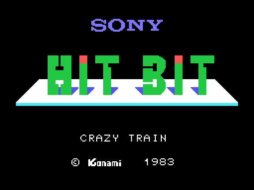
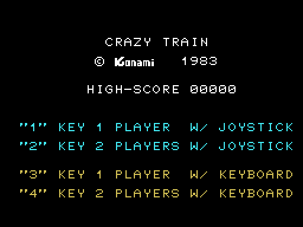
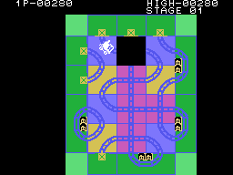

# The sequences

## The title and the menu

At power-on the title comes up: **SONY**, the **HIT BIT** logo, "CRAZY TRAIN"
and "(C) Konami 1983", for nine spans of 32 frames, about five seconds
(`init`, 0x0160). Then the menu (`menu`, 0x021C): the high score and the four
options, the two joystick ones in one colour and the two keyboard ones in
another. If nobody chooses within 20 spans of 32 frames (about eleven
seconds), the demo starts.

Both pictures come from **running the cartridge itself** with
`tools/pantallas.py`, and they are **identical** to openMSX's dot by dot (0 of
49,152 different in each, and the same registers).

Keys **1** and **2** start with the joystick, one or two players; **3** and
**4**, with the keyboard (`elige_opcion`, 0x024D). On the title, the menu and
the demo, **fire**, the **space bar** or **SELECT** also start a game, with
the players of the previous one and joystick or keyboard depending on what was
pressed (`mira_disparo`, 0x10A9).

## Starting

Only the chosen option is left on the menu, with PLAYER 1 below it, the start
tune plays (`empieza_partida`, 0x028E) and the board appears. With two
players, every time the turn changes the screen goes blank with PLAYER 1 or
PLAYER 2 (`entra_el_otro`, 0x0721).

## The demo

It is the real game with a make-believe controller: for every square the
white train enters, the demo takes the next push from a strip of **16**
(0x13E2). It makes no sound, scores nothing and ends at the first crash, back
in the menu. Two details, measured in the recordings:

- The strip has 16 pushes, but nothing stops it going further: in one of the
  recorded demos the train enters 24 squares, and the last eight pushes come
  **from the title text**, which sits right after it (0x13F2).
- "STAGE 01" is not shown at the start (0x0441 skips it in the demo), but it
  appears **when the first station closes**: `cierra_estacion` (0x0A14)
  repaints the stage without checking for the demo.

## GAME OVER

When the last train is lost, GAME OVER comes up between two blank rows, with
its tune (`game_over`, 0x074C); with two players, the other one goes on if
they have trains left. Then eight spans of 32 frames: fire starts again and,
otherwise, the menu.

