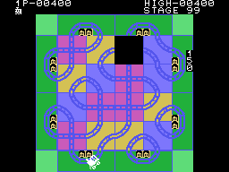

# Curiosidades

## Los fallos

### Un récord con diez puntos más que la partida

Cuando el tren entra en una casilla sin salida, primero se le dan los **10
puntos** de la casilla nueva y luego choca. El bucle de la partida pinta los
puntos (`pinta_puntos`, 0x056B) y justo después mira el récord (`mira_record`,
0x056E); si la interrupción cae **entre las dos**, el récord se lleva esos 10
puntos y el marcador del jugador no, porque tras el choque ya no se vuelve a
pintar. En el último tren, eso queda así para siempre:

Medido en la grabación `empuja.tcl`: en el cuadro 2057 la RAM tiene 290 puntos
y 290 de récord, y la pantalla, 280 y 290.

### Después de la fase 99, la 02

Al empezar una fase se suma uno a su número, en BCD; si pasa de 99 a 00, el
programa pone **2** (0x032C). Probado en openMSX con la fase puesta a 98
(`fase99.tcl`): STAGE 99 y, después, STAGE 02.

### La demostración se sale de su tira

La demostración saca un empujón por casilla de una tira de 16 (0x13E2) sin
mirar dónde acaba: si el tren dura más, lee el **texto del título** como si
fueran empujones. En una de las demostraciones grabadas llegó a la casilla 24
(0xE261 = 24).

### STAGE 01 a destiempo

En la demostración no se pinta la fase al empezar, pero `cierra_estacion`
(0x0A14) la vuelve a pintar sin mirar si es la demostración: "STAGE 01"
aparece al cerrar la primera estación.

## Lo que parece un fallo y no lo es

`pinta_cifras` (0x0C16) da la vida extra cuando los puntos **son** 5.000 (o
30.000, 60.000, 90.000), no cuando pasan de ahí: parecía que unos puntos que
saltasen por encima del umbral -una estación da 90 de golpe- se la comerían.
Pero en la comparación, B ya no son las decenas: lo ha pisado `ld b,a` (0x0C2F)
con las vidas extra dadas, y el `djnz` lo deja en cero. Solo cuentan los
**millares**, que suben de uno en uno, y la vida no se salta nunca. Probado en
openMSX con la partida en 4.900 y en 4.910 antes de una estación: las dos
veces, un tren más.

## El código de cada tren está en la RAM

Cada tren tiene una ficha de 32 bytes (la plantilla de 0x12B7), y **dentro
lleva código**: `ld b,(ix+n)`, `inc (hl)` sobre su propio desplazamiento `n`,
y `jp 0x0850`. `paso_de_tren` (0x0843) salta a él con `jp (hl)`: lee el byte
siguiente del guion del tren y se suma uno a sí mismo. Por eso hay código en
la ROM al que no salta nadie: 0x0850 y lo que sigue.

## Tablas que se pisan

Cuatro tablas seguidas (0x1297, 0x129F, 0x12A7 y 0x12AF) se leen con un
índice que empieza en 1, así que la entrada 0 de cada una son los últimos
bytes de la anterior. Y los nueve últimos bytes de la plantilla de las fichas
son los nueve primeros de la tabla de salidas (0x12CE): la plantilla se copia
entera a la RAM, con ese trozo de tabla dentro.

## Cinco parejas de seis

`psg_inicial` (0x0F1F) baja B tres veces por pareja (los dos `outi` y el
`djnz`). Aquí las cuentas cuadran: con B = 0x12 manda las seis parejas de
0x133A, y solo lo hace al arrancar la fase (0x0453); con B = 0x0F, antes de
cada música, las cinco primeras, sin la última, que abre el ruido de los
canales 2 y 3 para el traqueteo.

## La tercera voz, tarde

`canal_musica` (0x0103) no pone a cero lo que le queda a la nota cuando se le
cambia la pieza. La música de la fase superada entra cuando en el canal 3 aún
suena el traqueteo, así que su tercera voz empieza tarde lo que le quedara a
esa nota: de 0 a 7 cuadros. En la grabación, 1 (0xE3B2 = 1 en el cuadro 1205).

## Restos

- Un **`ret` suelto** en 0x084F, detrás del `jp (hl)` de `paso_de_tren`:
  ningún salto llega a él. Medido con una sonda en openMSX
  (`tools/sonda_ret.tcl`): en 20.000 cuadros de partida con empujones, ninguna
  vez (la misma sonda en 0x0850 cuenta 65 en 3.000).
- Las **24 casillas del interior del cuarto tablero** (0x1244-0x1261): desde
  la fase 4 el interior siempre se revuelve, y no se ven nunca.

## El volcado

El volcado de 32 KB (GoodMSX, `[!]`, sha1 `bbe8df03...`) es el que se usa: son
los mismos 8 KB cuatro veces. openMSX conoce **doce** volcados de Crazy Train,
este como GoodMSX, y ninguno marcado como verificado; los 8 KB solos (sha1
`8aca0ee5...`) también están en su lista.

## Preguntas abiertas

- **Por qué un 2** tras la fase 99, y no un 1.
- **Los otros volcados** de la lista de openMSX: en qué se diferencian de este.
