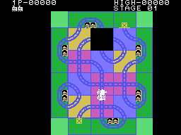
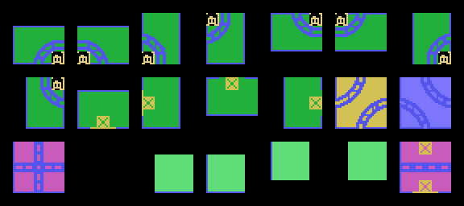
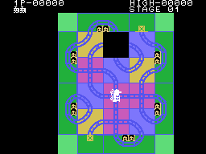
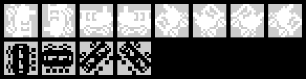
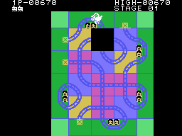
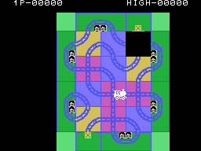
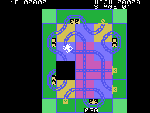

# La partida

El tablero es un puzle de piezas deslizantes con un hueco, y encima va un tren.
El tren **avanza solo** por las vías; el mando no lo mueve a él: **empuja hacia
el hueco** la pieza que está al otro lado (`mando_empuja`, 0x0F5F). Con eso hay
que irle poniendo vía por delante, y llevarlo por **todas las estaciones** del
marco para pasar de fase.

Todos los GIF de esta página son el cartucho **funcionando en openMSX**: en
cada cuadro se apuntan la VRAM y los registros del VDP, y `tools/vdp.py` los
pinta. Cada imagen dura lo que duró en el emulador.

## Las piezas

El tablero son 8 x 6 casillas de 4 x 4 letras (`pinta_tablero`, 0x0402); cada
casilla guarda el número de su pieza. Dentro del marco hay dos piezas de
curvas dobles (0x0C y 0x0D), el cruce (0x0E), la recta (0x14, solo en los
tableros revueltos) y el hueco (0x0F). El marco son las esquinas (0x10-0x13),
las estaciones (0x00-0x07, dos casillas por estación) y el marco sin estación,
con una cruz (0x08-0x0B). Las piezas del marco **no se mueven**: el empujón
solo vale con piezas de 0x0C en adelante (0x0FDB).

## El empujón

Arriba, abajo, izquierda o derecha mueven la pieza de al lado del hueco hacia
él, en **cuatro pasos de 8 puntos**, uno por cuadro (`desliza`, 0x0FEF). Entre
empujón y empujón hay que **soltar** el mando (0x0F8E). Si el tren está encima
de la pieza, **se mueve con ella** (`mueve_con_pieza`, 0x104E).

## El tren y su velocidad

El tren blanco avanza **un punto cada cuatro cuadros**; en diagonal, uno o dos
cuadros más por punto (la interrupción, 0x0086). El botón (o la barra)
acelera: apretado 32 cuadros seguidos, un cuadro menos por punto, hasta dos;
suelto 32 cuadros, vuelve a frenar hasta cuatro (`boton_acelera`, 0x0594).

Cada pieza lleva al tren por un **guion** de pasos: una recta son 32 puntos en
línea; una curva, 5 rectos, 11 en diagonal y 5 rectos (los guiones de 0x12FA).
Por dónde sale lo dice una tabla, según la pieza y el lado por el que entra
(`salidas`, 0x12CE).

## El choque

El tren blanco choca, y se pierde una vida (`fin_de_fase`, 0x06C3), cuando:

- llega a una pieza **sin vía por ese lado**: el hueco, el marco sin estación o
  una recta por arriba o por abajo (`callejon`, 0x0874);
- quiere entrar en la pieza que **se está deslizando** (0x0EC6), o llega al
  final de su pieza mientras esta aún se desliza con él encima (0x0864);
- **toca un tren negro** (`choque_blanco`, 0x04AC).

Tras la explosión, el tren sigue. Si chocó contra un callejón, **da media
vuelta** y vuelve a la casilla de la que venía: la tabla de salidas, para una
pieza sin vía, devuelve el lado por el que entró (0x12CE). Si chocó justo al
dejar una estación, sale de **otra estación al azar** de las que faltan
(0x06F5).

## Las estaciones

Cada estación son **dos casillas** del marco, con sus casitas. El tren la visita
cuando pasa por las dos (`entra_en_casilla`, 0x0DD6): suenan unas campanillas,
la estación se cierra (sus dos casillas pasan a ser marco con cruz, `cierra_estacion`,
0x0A14) y queda una menos. Sin estaciones, la fase está superada.

## Los trenes negros

Cada tres a seis casillas del tren blanco (al azar, `espera_negro`, 0x0DBC) se
**anuncia** uno: suena un aviso y junto a una estación sin visitar sale una
cuenta, **200**, que baja diez cada 48 cuadros (`cuenta_tren_negro`, 0x05EE).
Si el tren blanco pasa antes por esa estación, el negro ya no sale, y la cuenta
que quedaba se suma a los puntos (0x0DFA).

A cero, el tren negro **sale de la estación**, que queda cerrada y contada como
visitada (`cuenta_a_cero`, 0x0D8E). Si ya hay tres en marcha, no sale, y la
estación se cierra igual. Los negros avanzan un punto cada tres cuadros, por
las mismas vías. Si tocan al blanco, **estallan los dos**; si chocan entre
ellos, estallan los dos negros, y si estaban en una estación, esa estación
cuenta (`choque_negros`, 0x0502). Un negro que está en una estación que se
cierra, también estalla (0x0663). Un negro que llega a un callejón no choca:
pasa directamente a la casilla siguiente (0x0880), que por la tabla de salidas
es la de la que venía, así que **da media vuelta**. Es el mismo camino que
sigue el blanco tras su choque; con un negro no se ha visto en las
grabaciones.

## El tablero sin colores

A los **32 segundos** de cada fase (60 tramos de 32 cuadros, 0x0479), las
piezas **pierden el color de fondo** y solo quedan las vías: los colores de
0x1390 en lugar de los de 0x134E (0x048D). Se ve en el GIF de arriba.

## Los puntos y las vidas

| | Puntos |
|---|---|
| cada casilla nueva del tren blanco | 10 (no si va dando vueltas, ver abajo) |
| cada estación visitada | 90 |
| pasar por la estación anunciada antes que el tren negro | la cuenta que quedaba |
| la fase superada | 200 |

Antes de darle los 10 puntos de una casilla, el programa sigue la vía **por
adelantado** desde el tren (`mira_vueltas`, 0x062C): si vuelve a la misma
casilla con la misma dirección, el tren va en un circuito cerrado y no puntúa.

Se empieza con **tres trenes**, y hay uno más a los **5.000 puntos** y luego a
los 30.000, 60.000 y 90.000 (`pinta_cifras`, 0x0C16). Con dos jugadores se
juega por turnos: cada uno con su tablero, su fase y sus estaciones, y el turno
pasa al otro con cada vida perdida (`cambia_jugador`, 0x070B).
