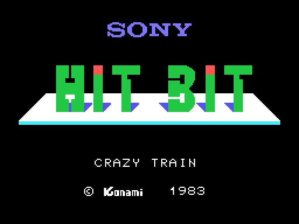
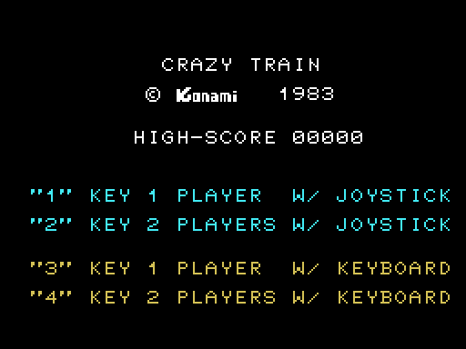
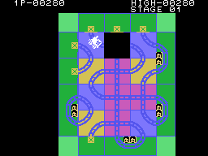

# Las secuencias

## El título y el menú

Al encender sale el título: **SONY**, el logotipo de **HIT BIT**, "CRAZY TRAIN"
y "(C) Konami 1983", durante nueve tramos de 32 cuadros, unos cinco segundos
(`init`, 0x0160). Luego el menú (`menu`, 0x021C): el récord y las cuatro
opciones, las dos del mando en un color y las dos del teclado en otro. Si nadie
elige en 20 tramos de 32 cuadros (unos once segundos), empieza la
demostración.

Las dos imágenes salen de **ejecutar el propio cartucho** con
`tools/pantallas.py`, y son **idénticas** a las de openMSX punto a punto (0 de
49.152 distintos en cada una, y los registros iguales).

Las teclas **1** y **2** empiezan con el mando, uno o dos jugadores; **3** y
**4**, con el teclado (`elige_opcion`, 0x024D). En el título, en el menú y en la
demostración, el **disparo**, la **barra** o **SELECT** empiezan también una
partida, con los jugadores de la vez anterior y el mando o el teclado según lo
que se haya pulsado (`mira_disparo`, 0x10A9).

## Al empezar

Del menú se queda solo la opción elegida y PLAYER 1 debajo, suena la música
de salida (`empieza_partida`, 0x028E) y aparece el tablero. Con dos jugadores,
cada vez que el turno cambia la pantalla se queda en blanco con PLAYER 1 o
PLAYER 2 (`entra_el_otro`, 0x0721).

## La demostración

Es la partida de verdad con un mando de mentira: por cada casilla en la que
entra el tren blanco, la demostración saca el empujón siguiente de una tira de
**16** (0x13E2). No suena, no puntúa y acaba con el primer choque, en el menú.
Dos detalles, medidos en las grabaciones:

- La tira tiene 16 empujones, pero nada impide pasar de ahí: en una de las
  demostraciones grabadas el tren entra en 24 casillas, y los ocho últimos
  empujones salen **del texto del título**, que está detrás (0x13F2).
- "STAGE 01" no sale al empezar (0x0441 lo salta en la demostración), pero
  aparece **al cerrar la primera estación**: `cierra_estacion` (0x0A14) vuelve
  a pintar la fase sin mirar si es la demostración.

## El GAME OVER

Al perder el último tren sale GAME OVER entre dos filas en blanco, con su
música (`game_over`, 0x074C); con dos jugadores, el otro sigue si le quedan
trenes. Después, ocho tramos de 32 cuadros: un disparo vuelve a empezar y, si
no, el menú.

