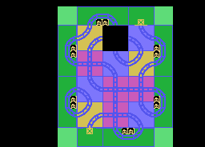
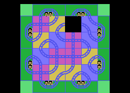
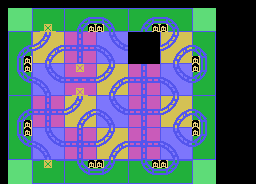
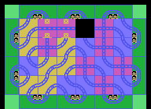
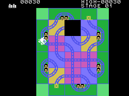
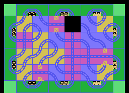
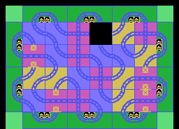
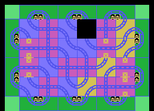
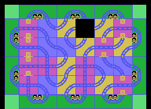

# Los tableros

El cartucho trae **cuatro tableros** de 8 x 6 casillas (0x11AB, 48 bytes cada
uno) y, para cada uno, la lista de sus estaciones (0x115F). Cada fase empieza
con el tablero que le toca, el hueco en la casilla 12 y el tren blanco en un
cruce, la casilla 28, mirando hacia arriba (la plantilla de 0x12B7). Al acabar
una fase se pasa al tablero siguiente; desde el cuarto, el interior se
**revuelve** en cada fase.

Las imágenes salen de **los bytes del cartucho**: el tablero de la ROM, casilla
a casilla con sus piezas, pintado con las letras y los colores que el propio
cartucho sube a la VRAM (`tools/graficos.py`, que ejecuta INIT con
`tools/z80run.py`). Cada una se ha cotejado **punto a punto** con la pantalla
de openMSX al empezar esa fase: **0 puntos distintos** en las ocho, de la fila
2 a la 23 (en las dos primeras van los marcadores).

| Fase | Tablero | Interior | Estaciones |
|---|---|---|---|
| 1 | el primero | 3 x 4 | 6 |
| 2 | el segundo | 4 x 4 | 8 |
| 3 | el tercero | 5 x 4, con una recta | 8 |
| 4 en adelante | el cuarto, revuelto | 6 x 4, con rectas | 10 |

## La fase superada

Con la última estación suena la música de la fase, se suman 200 puntos y sale
el tablero siguiente (`fase_superada`, 0x03BD).

## El cuarto tablero, revuelto

Desde la fase 4, `tablero_revuelto` (0x0B5A) rellena las 24 casillas del
interior con una tira de 18 piezas (0x126B), empezando en un sitio que depende
del número de fase, y pone el hueco en la 12 y un cruce en la 28. Después
cambia unas cuantas casillas por **rectas** (la pieza 0x14, que solo deja pasar
de lado), en los sitios de una lista (0x127E): dos en la fase 4, una más en
cada fase hasta seis en la 8, seis hasta la 14, siete de la 15 a la 20 y ocho
desde la 21.

Dos detalles medidos:

- El número que usa es el de la **fase anterior**: el tablero se prepara
  (0x0313) antes de que la fase suba (0x0320). La fase 4 se revuelve con un 3.
- Las 24 casillas del interior del cuarto tablero de la ROM (entre 0x1244 y
  0x1261) **no se ven nunca**:
  desde la fase 4 siempre se revuelve, y lo tapa entero.

El número de fase va en BCD, y lo que cuenta para el sitio de partida es,
sobre todo, su última cifra. Calculado con el mismo programa que da los
tableros cotejados: de la fase 21 en adelante **los tableros se repiten cada
diez fases** (la 31 es la 21, la 32 es la 22...): solo hay diez distintos.
